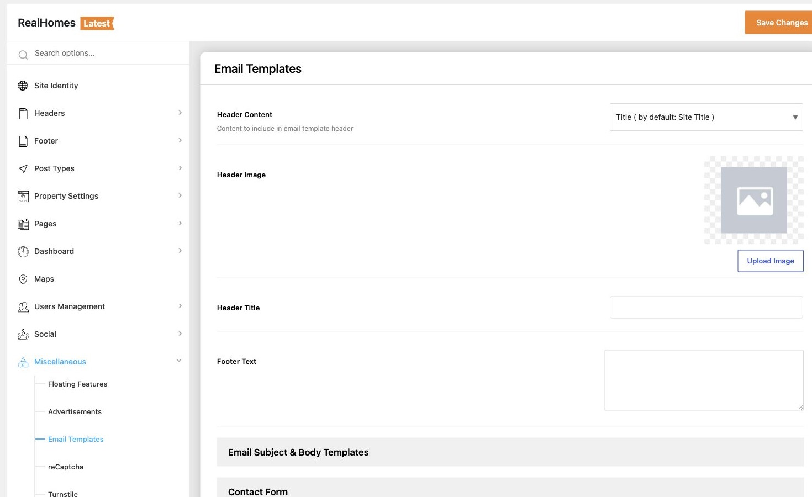
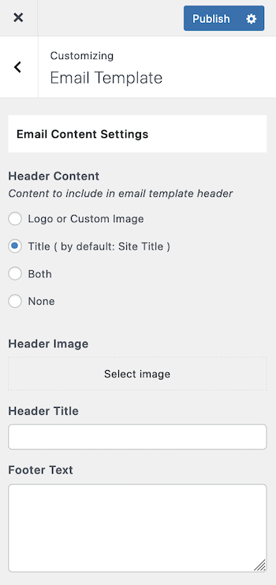
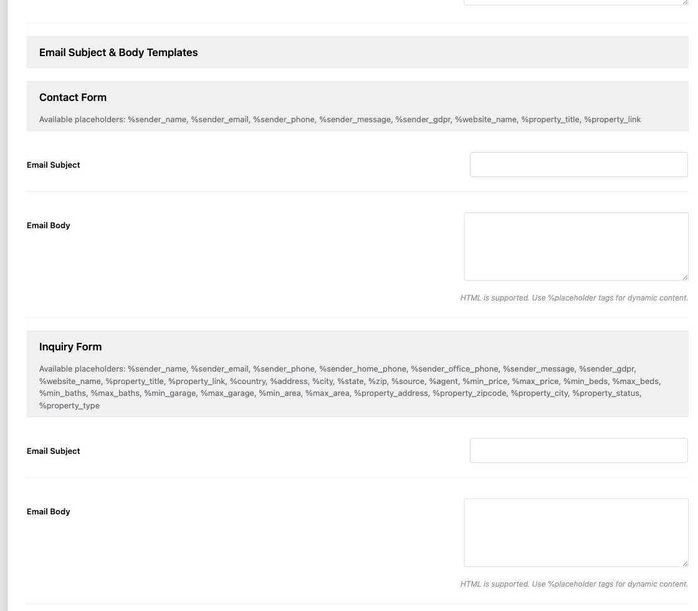
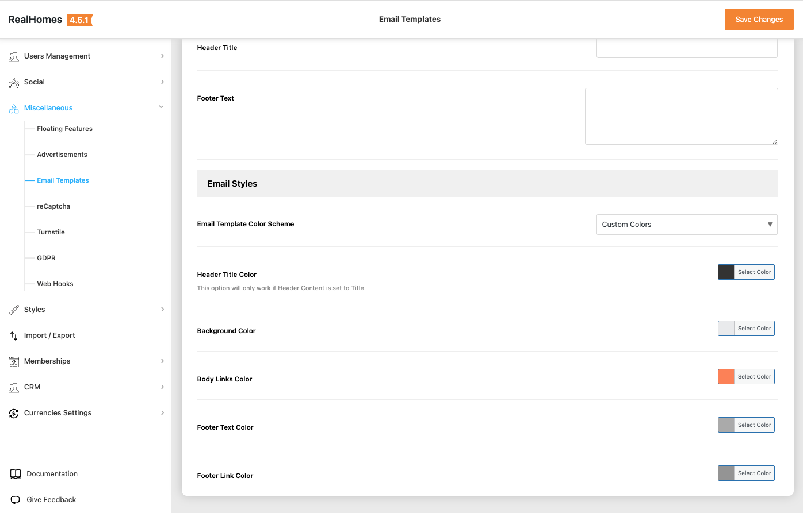
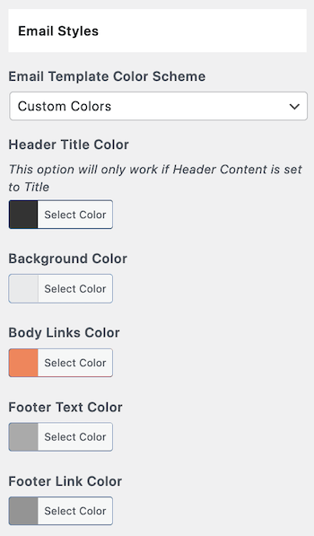

# Email Template

RealHomes email template settings let you manage the common email layout, header, footer, colors, and the custom subject/body content used by supported RealHomes form emails.

As of **v4.5.5**, RealHomes includes dedicated **Email Subject & Body Templates**, so you can customize important form emails without editing theme or plugin files.

## **Settings Location**

Follow the navigation path based on your version:

=== "v4.5.1 and Later"

    !!! success "RealHomes Settings"
        Dashboard ➤ RealHomes ➤ Settings ➤ Miscellaneous ➤ Email Templates

    

=== "v4.5.0 and Earlier"

    !!! info "Legacy Settings"
        Dashboard ➤ RealHomes ➤ Customize Settings ➤ Email Template

    You can manage email template's content settings.

    

## **Header and Footer Content**

Use the first part of the Email Templates screen to control the shared email layout. You can configure:

- **Header Content** - Choose whether the email header displays a logo/custom image, title, both, or none.
- **Header Image** - Upload the logo or image used in the email header.
- **Header Title** - Add a custom title when the header title option is enabled.
- **Footer Text** - Add the footer content displayed at the bottom of RealHomes emails.

## **Email Subject and Body Templates**

This feature is available in **v4.5.5 and later**.

The **Email Subject & Body Templates** section lets you customize both the subject line and message body for supported RealHomes emails. Each form type displays its own available placeholders so you can insert dynamic values from the submitted form or related property.

Each supported form group includes:

- **Available placeholders** - Shows the dynamic tags supported by that specific email.
- **Email Subject** - Replaces the default subject line for that email.
- **Email Body** - Replaces the default message body for that email. HTML is supported.

Leave a subject or body field empty to keep the default RealHomes content for that specific field. This lets you customize only the subject, only the body, or both.

## **Supported Emails**

Custom subject and body templates are available for these RealHomes form emails:

| Email Template | Common Use |
| --- | --- |
| Contact Form | General property or website contact messages. |
| Inquiry Form | Detailed property inquiry submissions. |
| Contact Form Over Slider | Home page slider contact form submissions. |
| Agent Contact Form | Messages sent from an agent contact form. |
| Agency Contact Form | Messages sent from an agency contact form. |
| Report Property Form | Property report submissions. |
| Schedule a Tour | Tour request messages with date, time, type, and property details. |

## **Using Placeholders**

Placeholders allow you to insert dynamic content into your custom email subject or body. You can seamlessly mix regular text with these placeholders. 

To use a placeholder, copy the exact tag as displayed in the settings screen (including the `%` prefix) and paste it into your subject or body field.

**Common examples include:**

- `%sender_name`
- `%sender_email`
- `%sender_phone`
- `%website_name`
- `%property_title`
- `%property_link`
- `%tour_date`
- `%tour_time`

!!! tip "Placeholder availability"
    Placeholder availability changes by email type. Use only the placeholders listed under the form group you are editing.

## **Email Template Styles**

You can also customize the visual appearance of your emails to match your brand identity. The styles of the email template can be managed in this section.

=== "v4.5.1 and Later"

    !!! success "RealHomes Settings"
        Dashboard ➤ RealHomes ➤ Settings ➤ Miscellaneous ➤ Email Templates

    

=== "v4.5.0 and Earlier"

    !!! info "Legacy Settings"
        Dashboard ➤ RealHomes ➤ Customize Settings ➤ Email Template

    

---

## **Testing Your Templates**

After configuring your email templates and styles, it is highly recommended to test them to ensure they appear exactly as intended.

1. **Submit a Test Form:** Go to your website's front end and submit a test inquiry, contact form, or schedule a tour request.
2. **Review the Email:** Check your inbox to verify that the subject, body placeholders, header image, and custom styles are rendering correctly in your email client.
3. **Refine as Needed:** If any placeholders are missing or the layout looks incorrect, return to the **Email Templates** settings to make adjustments.

!!! tip "HTML Formatting"
    If you choose to use HTML in your **Email Body**, make sure all your HTML tags are properly closed so that the email renders correctly across different email clients like Gmail, Outlook, or Apple Mail.
