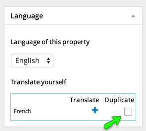
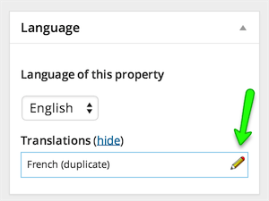
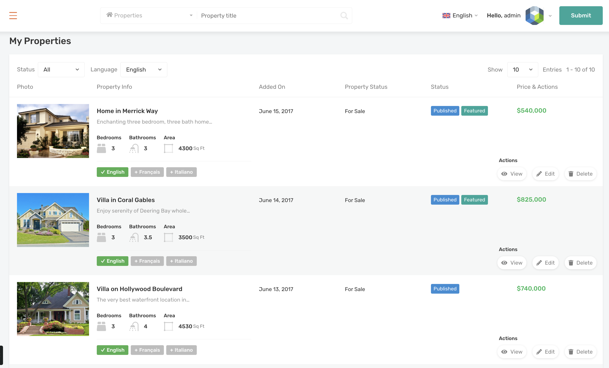

# Translate a Property

1. Go to **Dashboard → Properties** in WordPress admin side and start editing a property.

2. Look for language meta box in right sidebar, Check the duplicate checkbox and duplicate the property in other language . 

The page will refresh and property will be duplicate. 

Duplicating a property will save you from lots of hard work.

3. Now, Open the duplicated property for editing by clicking on pencil icon. 

4. On translated property's edit page, Go through all the fields one by one and provide the translated information.

5. In agent field you need to choose the translated agent ( You will not have any in start, But you can translate one easily using below given instructions ) 

!!! note
    Update the property that is currently being editing before moving ahead with agent's translation.

**To Translate an Agent:** Simply open an agent for editing and duplicate it into other language. Open the duplicated agent for editing and update the english information into translated information then update the agent. 

Refresh the translated property edit page, or re-open the translated property for editing and you will have the translated agent in agent field's select box.

## Frontend Dashboard Translations

With recent updates, RealHomes also supports complete WPML translation features directly from the frontend **RealHomes Dashboard**. This applies to the **Property, Agent, and Agency** modules.

### Translating via Dashboard

1. **Inline Translation Buttons**: The most convenient way to translate existing items is directly from your dashboard list. Under each property, agent, or agency in your list, you will see language badges (e.g., `✓ English`, `+ Français`). Clicking the `+` button will take you directly to the submission form to add the translation for that specific language.
2. **Dashboard Language Switcher**: A global language switcher is available in the top navigation bar of the dashboard. Users can switch the active language to view and manage listings in different languages.
3. **List Filtering**: A **Language** dropdown filter is available above the list, allowing users to quickly filter their properties, agents, or agencies by a specific language.
4. **Submit Forms Language Selector**: When submitting a new item from scratch, users will find a WPML language selector directly in the form to specify the language of the new submission.

!!! note
    Ensure that you have configured WPML correctly and have enabled the translation options for properties, agents, and agencies in the WPML settings for the frontend controls to appear.
